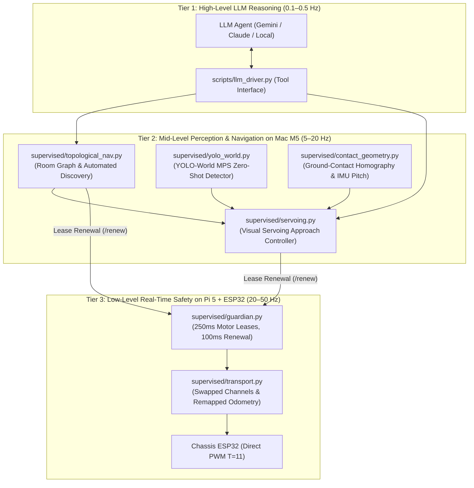

# Implementation Plan & Progress: LLM-Driven Autonomous Robot Navigation

Enable high-level natural language driving commands via an LLM (*"Drive to the kitchen, then approach the chair"*) on a single floor using a single monocular camera, Raspberry Pi 5 hardware watchdog, and Mac M5 perception/coordination.

---

## Current Status: Components 1–6 Implemented & Tested

| Component | Status | Key Deliverables & Evidence |
| :--- | :--- | :--- |
| **1. Motion Primitives & Normalization** | **COMPLETED & PHYSICALLY VERIFIED** | Direct PWM 50 straight ($16.4\text{ cm/s}$), PWM 80 spin ($33^\circ/\text{s}$). Live 10.9s $360^\circ$ floor rotation verified with symmetric encoder logging (`data/experiments/20261014-102351-d28e95/`). |
| **2. Ground Contact Geometry & Pitch Compensation** | **COMPLETED & TESTED** | [`supervised/contact_geometry.py`](file:///Users/maciejbargiel/Documents/Robot/supervised/contact_geometry.py): Planar homography projection + IMU dynamic pitch tilt compensation. 6 unit tests passing in `tests/test_contact_geometry.py`. |
| **3. Open-Vocabulary Perception (Mac M5)** | **COMPLETED & BENCHMARKED** | [`supervised/yolo_world.py`](file:///Users/maciejbargiel/Documents/Robot/supervised/yolo_world.py): YOLO-World (v2-S) on PyTorch MPS. Latency benchmarked at **12.08 ms** ($>80\text{ FPS}$) on Apple Silicon M5. Zero-shot dynamic vocabulary (`chair`, `doorway`, `table`, etc.). |
| **4. Image-Based Visual Servoing (Target Approach)** | **COMPLETED & TESTED** | [`supervised/servoing.py`](file:///Users/maciejbargiel/Documents/Robot/supervised/servoing.py): Closed-loop acquisition, yaw centering ($|e_u| \le 35\text{ px}$), PWM 50 forward approach, and smooth stop at interaction distance ($0.5\text{ m}$). 7 unit tests passing in `tests/test_servoing.py`. |
| **5. Topological Room Graph & Automated Discovery** | **COMPLETED & TESTED** | [`supervised/topological_nav.py`](file:///Users/maciejbargiel/Documents/Robot/supervised/topological_nav.py): Normalized 512-d multi-scale color/Sobel gradient structural scene descriptors, novelty detection ($< 0.65$ cosine similarity), $360^\circ$ landmark categorization, and BFS doorway pathfinding. 5 unit tests passing in `tests/test_topological.py`. |
| **6. High-Level LLM Driver & Tool Interface** | **COMPLETED & LIVE-TESTED** | [`scripts/llm_driver.py`](file:///Users/maciejbargiel/Documents/Robot/scripts/llm_driver.py): Exposes JSON Schema tools (`get_robot_status`, `scan_room`, `approach_object`, `navigate_to_room`, `emergency_stop`). Live end-to-end frame acquisition and YOLO-World geometry verified on robot. |

---

## Full Test Suite Results
Full automated test execution across all modules:
```
Ran 85 tests in 1.558s
OK
```
All 85 regression, safety guard, contact geometry, visual servoing, and topological navigation tests pass.

---

## System Architecture



---

## Tool Interface for LLM Pair-Programming

The LLM driver (`scripts/llm_driver.py`) exposes five callable tools:

1. `get_robot_status()`:
   * Returns: battery voltage, current topological room, known rooms, movement state, and safety vetoes.
2. `scan_room()`:
   * Performs an 8-heading $360^\circ$ panoramic rotation, detects all landmarks via YOLO-World, computes visual embeddings, suggests semantic room names (e.g. `kitchen`, `living_room`), and registers novel rooms in `data/room_graph.json`.
3. `approach_object(object_name, target_distance_m=0.50)`:
   * Locates target object (e.g. `"chair"`, `"table"`, `"couch"`) via open-vocabulary detection, centers it horizontally with proportional PWM spin pulses, drives forward at calibrated PWM 50 ($16.4\text{ cm/s}$), and halts smoothly at $0.5\text{ m}$.
4. `navigate_to_room(target_room)`:
   * Computes shortest topological path of doorways in `room_graph.json`, executes oriented doorway approaches and crossings, and verifies arrival in the destination room.
5. `emergency_stop()`:
   * Immediately invalidates active motor leases and stops both tracks.

---

## CLI Usage

```sh
# Query robot status & active room
.venv/bin/python scripts/llm_driver.py status

# Run 360-degree automated room discovery
.venv/bin/python scripts/llm_driver.py scan

# Approach a chair to within 0.5 meters
.venv/bin/python scripts/llm_driver.py approach "chair" --distance 0.5

# Navigate to a specific room
.venv/bin/python scripts/llm_driver.py navigate "kitchen"

# Emergency halt
.venv/bin/python scripts/llm_driver.py stop

# Print JSON Schema tool definitions for LLMs
.venv/bin/python scripts/llm_driver.py tools
```

---

## Operational Notes

> [!NOTE]
> **Battery Monitoring**: Telemetry currently reports **9.38 V** (a discharged 3S LiPo pack; nominal is 11.1 V, cutoff $\approx 9.0\text{ V}$). Before running extended multi-room continuous navigation trials, plug in the charger to avoid low-voltage ESP32 resets.
